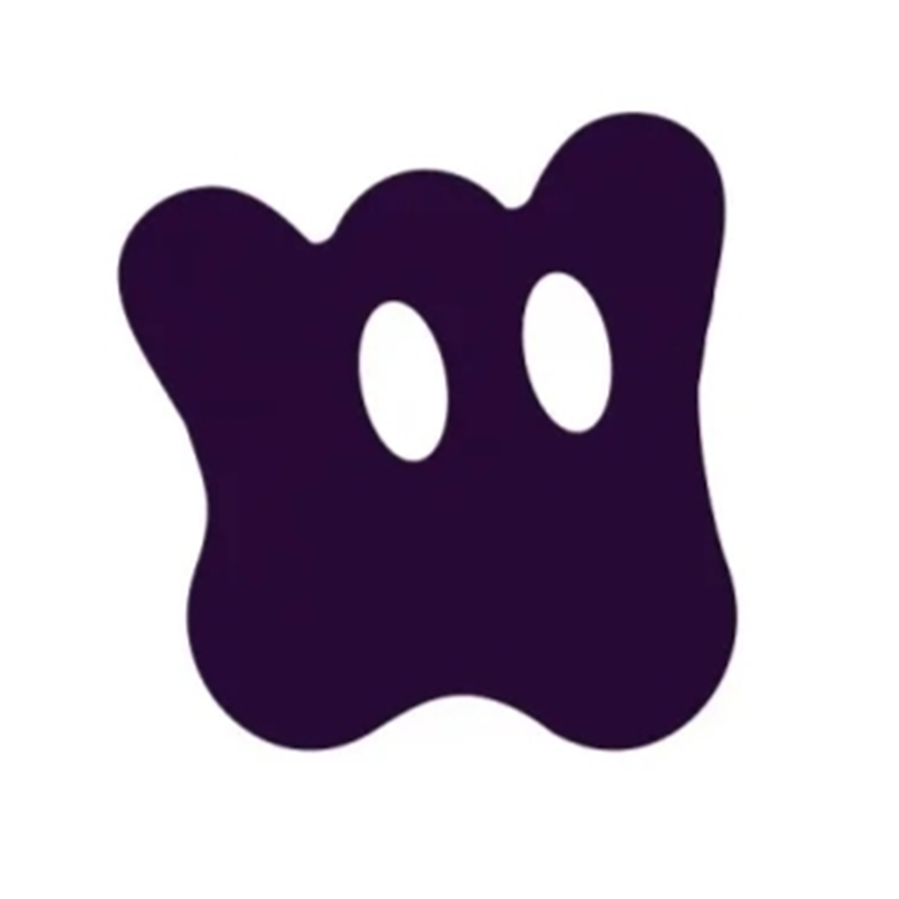

<!-- prettier-ignore -->
<div align="center">



# LiteVideo

**An unofficial HarmonyOS / OpenHarmony YouTube client — a personal-use fork of YourPipe**

[](https://github.com/Ember5843/YourPipe)
[](LICENSE)
[](https://github.com/mpv-player/mpv)

> Unofficial client. Not affiliated with YouTube or Google LLC.
> 个人自用版本：不发布 Release、不上架应用市场、不提供技术支持。

</div>

---

## 1. 概述

LiteVideo 是 [YourPipe](https://github.com/Ember5843/YourPipe)（作者 Talon）的 fork，分叉基点为上游
`v0.7.0`（commit `c3d985bb`，2026-10-22）。本仓库仅收录在该基点之上进行的自用改动；播放器内核、
YouTube 抽取器、鉴权链路、下载、代理与实验性功能等均沿用上游实现，其行为以上游为准。

许可证不变：**GNU GPL-3.0**（全文见 [LICENSE](LICENSE)）。上游授予的复制、修改、再分发及商用权利
同样适用于本仓库，本 fork 不附加任何额外限制。

| 项目 | 值 |
|---|---|
| Bundle name | `com.github.da3456.litevideo` |
| Application label | `LiteVideo` |
| Version | `1.0.25`（`versionCode 1000225`，编号独立于上游 `0.x` 线） |
| Upstream | `com.talon.yourpipe` · `Ember5843/YourPipe` |
| Target SDK | `26.0.0`（最低兼容 `6.1.0(23)`）· HarmonyOS · stage model |
| Supported devices | phone · tablet · 2-in-1 · TV · car |

包名与上游刻意不同：两个 HAP 位于相互隔离的应用沙箱，可与原版 YourPipe 共存安装、分别登录不同账号，
设置与数据互不影响。

## 2. 基于原版的功能改动

以下逐条列出本 fork 在原版 YourPipe 之上改动的应用功能，都是使用过程中能直接看到的差别。

- **订阅会同步到 YouTube 账号**：登录后点订阅 / 取消订阅，除了更新本地列表还会同时写回 YouTube，
  换设备或重装后订阅列表保持一致；写入失败会恢复原状态并提示「订阅操作未能同步到 YouTube」。
  未登录时的订阅只在本机生效，登录后也不会把之前攒下的订阅批量上传。
- **订阅列表与账号核对**：在订阅页显示或下拉刷新、进入播放详情页、进入我的页、完成登录后，
  会用账号里的频道名单校准本地列表——账号中已取消的会被去掉，账号中新增的会补进来；
  刚在本机做的订阅在短时间内不参与校准，离线订阅不会被误删。
- **取消订阅需要二次确认**：频道卡片、频道页、频道长按菜单的退订都会先弹出
  「确定取消订阅“某某频道”吗？」，确认之后才移除并同步账号。
- **订阅按钮统一为圆形图标**：频道卡片与频道页在两种状态下都是同一个圆形按钮，
  已订阅为灰底对勾、未订阅为主题色的笑脸加号，不再出现文字按钮。
- **首页卡片长按菜单改为从底部弹出**：原版是在卡片上盖一个小浮层，会把卡片顶得往上跳；
  现在改为满宽的底部面板，一项一行，下滑顶部把手或点击空白处收起。
- **频道卡片有独立的长按菜单**：只包含频道级操作——打开频道 / 订阅或取消订阅 / 分享频道，
  不再和视频卡片的菜单混用。
- **首页卡片新增「不感兴趣」「不推荐该频道」「保存到“稍后观看”」**：都是提交给 YouTube 服务端的操作，
  客户端不维护任何本地屏蔽名单。前两项已真机验证：点击后服务端受理，该条立刻从当前这批信息流里消失
  （与网页端一致），后续的推荐变化按服务端的节奏体现，账号里没有可核对的反馈清单；
  服务端没有随卡片下发反馈标记时不显示这两项。「保存到“稍后观看”」写入账号的稍后观看列表，
  未登录时提示先登录，不做本地代存。
- **首页信息流按批加载**：一次约 60 条（3 页），取满后停止自动翻页并提示这批已看完；
  下拉刷新，或已停在首页时再点一次底栏首页页签，开始下一批。下滑到底仍是无感取下一页的手感。
  列表不做去重、不做过滤，服务端推什么就显示什么。
- **卡片显示向 YouTube 网页端看齐**：相对发布时间压缩成短形（`4 hours ago` → `4h ago`，
  服务端文案认不出「数字 + 单位词」时原样显示）；网格卡片每行高度固定对齐，
  标题偏短也占据两行、缺失的信息行留空位，避免两列看起来错位。
- **长按缩略图也能呼出菜单**：原版的缩略图图层会把长按事件吃掉，只有文字区能弹菜单。
- **移除收藏视频功能**：卡片上的收藏按钮、卡片长按菜单里的收藏项、播放列表卡片的心形按钮、
  以及页面上方的「我收藏的视频」分区全部去掉；底栏第三个页签由「收藏」改为「播放列表」，
  内容是订阅动态入口加上账号 / 收藏 / 本地三类播放列表的合并列表（收藏的播放列表照常显示）。
  此前收藏过的视频数据仍保留在本地，也仍会进入设置备份与「清除应用全部数据」的范围。
- **内容语言与内容地区默认跟随系统**：原版默认锁在「英语 / 美国」，现在两项默认都是「跟随系统」，
  没有手动改过设置时，请求内容用的语言与地区直接取设备系统设置；仍可在
  设置 → 语言与地区 里手动指定。
- **上游的社群与商店入口保留，但标注为原版渠道**：「关于」页的 QQ 群、Telegram 群与更新页的 AppGallery
  测试渠道（AppTest）都在，只是下面写清了它们由原版 YourPipe 的作者运营、LiteVideo 不在这些渠道里答疑，
  方便仍在用原版的用户直接找到入口。LiteVideo 本身不分发商店包，也没有 Release。
- **「关于」页只留身份与渠道**：在包名 / 仓库 / 上游项目三行下面，补了 LiteVideo 与原版 YourPipe
  各自的图标 + 名称两行，再往下才是原版社群入口；原版的「项目信息」栏（开源项目、AI 厂商、更新日志入口）已移除。

其余部分——播放、清晰度与取流、网络与代理、下载、搜索、字幕与翻译、直播聊天、实验性功能等——
与原版一致，使用方式没有变化。

## 3. 版本记录

| 版本 | 日期 | 说明 |
|---|---|---|
| 1.0.25 | 2026-11-05 | 内容语言 / 内容地区的默认值改为「跟随系统」（不再锁英语 / 美国）；「关于」页补上 LiteVideo 与原版 YourPipe 的图标 + 名称两行，并移除「项目信息」栏。 |
| 1.0.24 | 2026-11-05 | 「关于」页与更新页恢复原版的 QQ 群 / Telegram 群 / AppTest 渠道入口，并在入口下方注明这些渠道属于原版 YourPipe。 |
| 1.0.23 | 2026-11-05 | 首个对外提交的整理版本：完成 fork 身份改造、README 与第三方许可清单重写、全部自用改动入库（单个提交，基点 `c3d985bb`）。 |

`1.0.6`–`1.0.22` 为本地自用迭代，仅以未签名 HAP 形式在本人设备上安装，未单独留档。应用内「更新检查」
读取本仓库 Releases；本 fork 未发布 Release，因此检查会静默返回无结果。

## 4. 构建

环境要求：DevEco Studio 或 HarmonyOS 命令行工具链，SDK `6.1.0(23)` 及以上。

```bash
cp build-profile.template.json5 build-profile.json5   # 本机配置，仓库中不提交
ohpm install --all
devecocli build                                       # 默认 debug 全产品构建
```

- `build-profile.json5` 为 git-ignored 的本机文件，签名材料不得提交（`.githooks/pre-commit` 会拦截）。
  无签名配置时产物为 `entry/build/default/outputs/default/entry-default-unsigned.hap`，需自行签名后侧载。
- 实际视频播放依赖 `arm64-v8a` 的 MPV 二进制；`x86_64`（模拟器）使用 `libmpv_napi` 的 UI stub。
- `libmpv.so.2` 与 FFmpeg 静态库为外部预先构建后随仓库提供，不由 Hvigor 生成，
  见 [libmpv_napi/AGENTS.md](libmpv_napi/AGENTS.md) §4。

## 5. 隐私

- 不含任何遥测或统计上报；运行日志仅在应用内本地留存，可在「设置 → 网络 → 应用日志」中开关。
- 登录通过应用内 WebView Cookie 或设备码 OAuth 完成，凭证仅保存在本机应用沙箱。
- 本 fork 不收集、不上传用户数据，也不代任何用户保管账号凭证。

## 6. 风险提示

本项目是非官方客户端，通过逆向 InnerTube 获取音视频流，与 YouTube 服务条款存在冲突；使用登录态时
可能触发风控（机器人校验、登录失效等）。该风险为所有第三方 YouTube 客户端共有，本仓库不承担相应后果。

## 7. License

GPL-3.0，见 [LICENSE](LICENSE)。第三方组件的许可、版本与出处清单见
[LICENSES/THIRD-PARTY-NOTICES.md](LICENSES/THIRD-PARTY-NOTICES.md)。
上游项目的版权声明，以及各源文件中既有的 `© Huawei Device Co., Ltd.` 许可样板头，均原样保留。

如需支持此类工作，建议直接支持上游 **YourPipe**，以及底层项目的维护者：**MPV**、**FFmpeg**、
**NewPipe** / **NewPipe Extractor** / **PipePipe**。本仓库不提供捐赠或收款入口。
